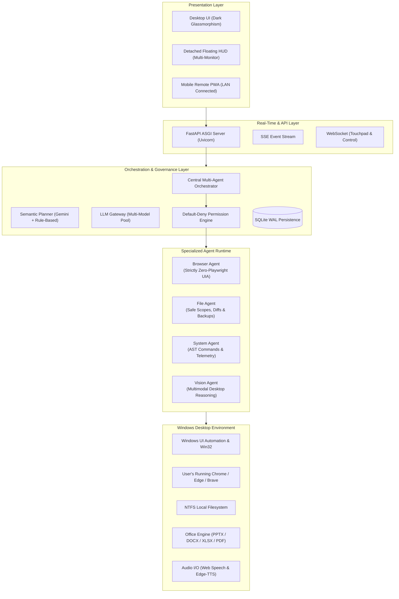
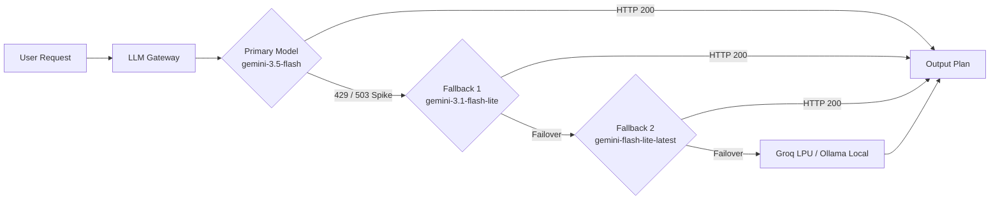

# Autonomous Multi-Agent Windows OS Assistant
## Technical Architecture & Technology Stack Specifications

> **System Classification:** Autonomous Multimodal Desktop Operating Assistant  
> **Target Platform:** Microsoft Windows 10 & 11 (64-bit)  
> **Architecture Paradigm:** Multi-Agent Coordination with Central Orchestrator & Local Security Enforcement  
> **Deployment Model:** Standalone Portable Desktop Executable (`.exe`) + Local Network (LAN) Mobile Remote  

---



---

## 1. System Overview & Architectural Principles

The application is an **autonomous, multimodal AI operating system assistant** designed to interact directly with the user's real Windows environment. Unlike traditional coding bots or terminal wrappers, it operates user applications, drives browsers without synthetic sandboxes, modifies actual files, reasons over desktop screens, and communicates across local network devices.

### Core Architectural Mandates
1. **Four Specialized Agents, One Orchestrator:** Work is routed through narrow-domain agents (`Browser`, `File`, `System`, `Vision`) governed by a single Plan-Execute-Verify ReAct coordinator.
2. **Zero Playwright / Zero Headless Browser:** The assistant operates the user's *already-running, already-authenticated* Chrome, Edge, or Brave browser via Windows accessibility trees (UIA) and keyboard/mouse hooks, keeping logins, cookies, and sessions intact.
3. **Local Default-Deny Security:** Permission policies are strictly evaluated in trusted Python code before execution, never delegated to LLM instructions.
4. **Resilient Multi-Model AI Gateway:** Automatic sub-second failover across Google Gemini high-availability models, Groq Cloud LPUs, and local offline Ollama runtimes.

---

## 2. Comprehensive Technology Stack Breakdown

### 2.1 Backend Core & API Services

| Component | Technology / Library | Version / Spec | Technical Purpose |
|---|---|---|---|
| **Runtime Environment** | Python 64-bit | 3.11.x | Core execution runtime, async event loops, Win32 API binding |
| **Web Framework** | FastAPI | 0.115+ | High-throughput asynchronous REST API and endpoint routing |
| **ASGI Web Server** | Uvicorn | 0.30+ | Production ASGI server supporting HTTP/1.1 and WebSockets |
| **Data Validation** | Pydantic v2 | 2.8+ | Strict type checking, request/response serialization, JSON schemas |
| **Async HTTP Client** | HTTPX | 0.27+ | Connection-pooled asynchronous HTTP client for LLM and cloud APIs |
| **Real-Time Streaming** | Server-Sent Events (SSE) | W3C Standard | Unidirectional real-time streaming of task step events and logs |
| **Bidirectional Transport** | WebSockets (`websockets`) | 12.0+ | Low-latency mobile trackpad, touch events, and remote commands |
| **Database Persistence** | SQLite 3 (WAL Mode) | Native | Task states, audit trail, documents, and device pairing records |

---

### 2.2 Artificial Intelligence & LLM Gateway

The system uses a **provider-agnostic gateway** with automatic fallback cascades to ensure zero downtime during cloud provider traffic spikes or rate limits:



| Component | Provider / Engine | Models Supported | Capabilities |
|---|---|---|---|
| **Primary Cloud Reasoning** | Google Generative Language API | `gemini-3.5-flash`, `gemini-3.1-flash-lite`, `gemini-flash-lite-latest`, `gemini-3-flash-preview` | Sub-second dynamic planning, JSON tool calling, multi-turn conversational context |
| **Secondary Cloud Engine** | Groq Cloud API | Llama-3.3-70B-Versatile, Llama-3.1-8B-Instant | 500+ tokens/sec dedicated LPU hardware inference |
| **Local Offline Fallback** | Ollama (OpenAI-compatible API) | Llama-3.2 (3B), Qwen-2.5 (3B) | 100% offline, zero-quota, zero-network fallback at `http://127.0.0.1:11434/v1` |
| **Multimodal Vision** | Google Gemini Vision API | `gemini-3.5-flash`, `gemini-3.1-flash-lite` | Full-screen desktop OCR, error explanation, UI control coordinate mapping |
| **Audio Transcription** | Gemini Multimodal Audio | `gemini-3.1-flash-lite`, `gemini-3.5-transcribe` | Direct WAV/MP3/WEBM transcription for mobile and desktop voice input |

---

### 2.3 Specialized Agent Subsystems

#### 1. Browser Agent (Strictly Zero Playwright)
* **Underlying Technology:** Windows UI Automation (UIA) via Win32 API (`ctypes`, `OpenInputDesktop`, `EnumDesktopWindows`, `GetWindowTextW`).
* **Supported Browsers:** Google Chrome, Microsoft Edge, Brave Browser.
* **Capabilities:**
  * Active window and tab discovery without launching automation profiles.
  * Line-wise media control (YouTube web shortcut `/`, search input typing, single-tab playback).
  * Direct URL navigation and search engine dispatching (Google, YouTube, Bing, DuckDuckGo).
  * Secure credential typing with automated password masking in logs and UI.

#### 2. File Agent & Document Studio
* **Underlying Technology:** Native Python `pathlib`, `os`, `shutil`, `difflib`.
* **Path Containment:** Strict canonical resolved path scoping; prevention of `..` directory traversal and symlink escapes.
* **Backup & Diff Engine:** Automated pre-modification backups into `data/backups/` with unified diff previews before write execution.
* **Lock-Resilient Auto-Versioning:** Probes file handles (`r+b`) before write; automatically increments filenames (`_v2`, `_v3`) when files are locked open in Microsoft Office.
* **Document Generation Engines:**
  * **PowerPoint (`.pptx`):** `python-pptx` (16:9 widescreen, custom theme palettes, bento KPI cards, metric callouts).
  * **Word Document (`.docx`):** `python-docx` (executive banners, title headers, styled callouts, alternating row tables).
  * **Excel Spreadsheet (`.xlsx`):** `openpyxl` (multi-sheet workbooks, uppercase auto-sum formulas, freeze panes, auto-fit column widths).
  * **Executive Report (`.pdf`):** `reportlab` (Platypus engine, `NumberedCanvas` dynamic page counts, 2-column data tables).

#### 3. System Agent & Desktop Telemetry
* **Process & Hardware Telemetry:** `psutil` (CPU usage, RAM allocation, disk capacity, battery level and charging state).
* **Application Control:** Safe `subprocess.Popen` execution with structured argument lists (strictly zero string concatenation or raw shell injection).
* **Window Management:** Win32 API (`user32.SetForegroundWindow`, `user32.ShowWindow`, `user32.BringWindowToTop`).
* **Input Controller:** Direct synthetic keyboard and mouse events (`ctypes.windll.user32.SendInput`).

#### 4. Vision Agent
* **Screen Grabber:** `mss` (ultra-high-speed multi-monitor frame grabber, 60fps capable).
* **Image Processing:** `Pillow (PIL)` (RGB format conversion, JPEG compression, resolution scaling).
* **Multimodal Reasoning:** Sends base64 inline images directly to Gemini Vision API for UI element localization, error diagnosis, and state verification.

---

### 2.4 Voice & Speech Subsystems

| Feature | Engine / Technology | Protocol / Format | Features |
|---|---|---|---|
| **Speech-to-Text (STT) - Client** | W3C Web Speech API | Native Browser SpeechRecognition | Zero-latency microphone dictation, real-time feedback, push-to-talk |
| **Speech-to-Text (STT) - Server** | Gemini Multimodal Audio | `POST /api/speech/transcribe` | Server-side fallback accepting raw WAV/MP3/WEBM audio recordings |
| **Text-to-Speech (TTS)** | Microsoft Edge-TTS (`edge-tts`) | Audio Stream (MP3) | High-fidelity neural voices (`en-US-JennyNeural`, `en-IN-NeerjaNeural`) |
| **Speech Normalizer** | Custom RegEx Engine | Local Python | Strips markdown, code blocks, URLs, and JSON before speech synthesis |

---

### 2.5 Presentation Layer & Remote Access

#### Desktop Interface
* **Design Philosophy:** Dark-first cyberpunk/enterprise glassmorphism.
* **Frontend Stack:** Pure HTML5, Modern CSS3 (Grid & Flexbox), Vanilla ES6+ JavaScript.
* **Zero Bloat:** Zero heavy node frameworks (no React/Vue runtime bundle dependencies) for sub-millisecond local launch times.
* **Multi-Screen Floating HUD:** Detachable, Always-on-Top mini-HUD (`desktop_app/hud.html`) with dual-dock layout.

#### Mobile Remote (PWA over LAN)
* **Architecture:** Responsive mobile web app served directly by the laptop (`/remote.html`).
* **LAN Pairing:** Dynamic cryptographic pairing token with QR code generation.
* **Mini Trackpad:** Multi-touch gesture surface (cursor movement, left/right click, tap, dragging, scrolling).
* **Live Screen Mirror:** Configurable low-latency desktop screen streaming.
* **Controls:** Push-to-talk voice dictation, natural language command input, emergency stop button.

---

### 2.6 Security, Governance & Audit Logging

| Security Dimension | Technical Implementation | Policy |
|---|---|---|
| **Permission Gate** | Pure Python local evaluation (`backend/permission_engine.py`) | **Default-Deny** on all unrecognized or destructive operations |
| **Human Approvals** | Real-time Future/Promise resolution across desktop & mobile | 6 explicit choices: `Allow Once`, `Allow Session`, `Allow Project`, `Allow Full`, `Deny`, `Emergency Stop` |
| **Audit Trails** | SQLite database with Write-Ahead Logging (`ai_os.db`) | Comprehensive immutable audit events recording every action and timestamp |
| **Secret Sanitization** | Automatic regex masking in gateway and logger | API keys and passwords strictly masked (`********`) in UI and logs |
| **Path Isolation** | Resolved realpath checks against configured root directories | Hard block on symlinks, junctions, and relative parent traversal (`..`) |

---

### 2.7 Packaging, Distribution & Licensing

* **Executable Packaging:** PyInstaller 6.x (Compiles Python 3.11 runtime, FastAPI backend, SQLite, and frontend UI into a single self-contained `.exe`).
* **Zero Installation:** Requires no pre-installed Python, Node.js, C++ compilers, or external drivers on the client machine.
* **Demo Trial Guard (`backend/demo_guard.py`):**
  * Hardware-bound machine fingerprinting (UUID, Motherboard Serial, CPU hash).
  * Cryptographic HMAC-SHA256 timestamping and monotonic clock verification.
  * Real-time countdown trial pill displayed in desktop UI header.

---

## 3. Directory & Module Structure

```text
ai_os_assistant/
├── backend/
│   ├── agents/
│   │   ├── browser_agent.py      # UIA & Win32 browser automation (Zero Playwright)
│   │   ├── file_agent.py         # Scoped filesystem engine & backup diffs
│   │   └── system_agent.py       # Telemetry & validated process management
│   │   └── vision_agent.py       # Screen capture & visual reasoning
│   ├── desktop_runtime/
│   │   ├── capture.py            # MSS screen capture engine
│   │   └── controller.py         # SendInput mouse and keyboard driver
│   ├── config.py                 # Environment & hardware configuration
│   ├── db.py                     # SQLite WAL persistence & audit logger
│   ├── demo_guard.py             # Machine-bound trial licensing
│   ├── document_generator.py     # PPTX, DOCX, XLSX, and PDF production engine
│   ├── llm_gateway.py            # Multi-model inference gateway & failover pool
│   ├── main.py                   # FastAPI REST routes, SSE streams & WebSockets
│   ├── orchestrator.py           # Central multi-agent coordinator (ReAct loop)
│   ├── permission_engine.py      # Default-deny governance engine
│   ├── semantic_planner.py       # Intent router (LLM + rule-based fallback)
│   └── speech_service.py         # Edge-TTS & audio transcription engine
├── desktop_app/
│   ├── index.html                # Dark-first master desktop console
│   ├── app.js                    # UI logic, SSE stream consumer & Web Speech
│   ├── style.css                 # Enterprise glassmorphism layout
│   └── hud.html                  # Multi-monitor detached floating HUD
├── tests/                        # 45 automated unit and integration tests
├── build_demo.py                 # Production PyInstaller build automation
├── run_server.py                 # Development backend bootstrap
└── AGENTS.md                     # Persistent repository specification
```

---

## 4. Executive Summary for Client Delivery

| Metric / Dimension | Specification |
|---|---|
| **Core Architecture** | 4 Specialized Agents governed by 1 Central Orchestrator |
| **Supported OS** | Windows 10 & Windows 11 (64-bit) |
| **Browser Compatibility** | Google Chrome, Microsoft Edge, Brave Browser |
| **Browser Technology** | Windows UI Automation (UIA) — **Strictly Zero Playwright** |
| **LLM Inference** | Google Gemini 2.0/3.0/3.5, Groq Cloud (Llama-3.3-70B), Local Ollama |
| **Document Formats** | PowerPoint (`.pptx`), Word (`.docx`), Excel (`.xlsx`), PDF (`.pdf`) |
| **Voice Support** | Client Web Speech + Server Gemini Audio Transcription + Neural Edge-TTS |
| **Mobile Access** | Touchpad, Screen Mirror, Voice & Commands over LAN (PWA) |
| **Security Standard** | Local Default-Deny, 6-Choice Human Governance, SQLite WAL Auditing |
| **Distribution** | Portable Zero-Install Windows Executable (`.exe`) |
